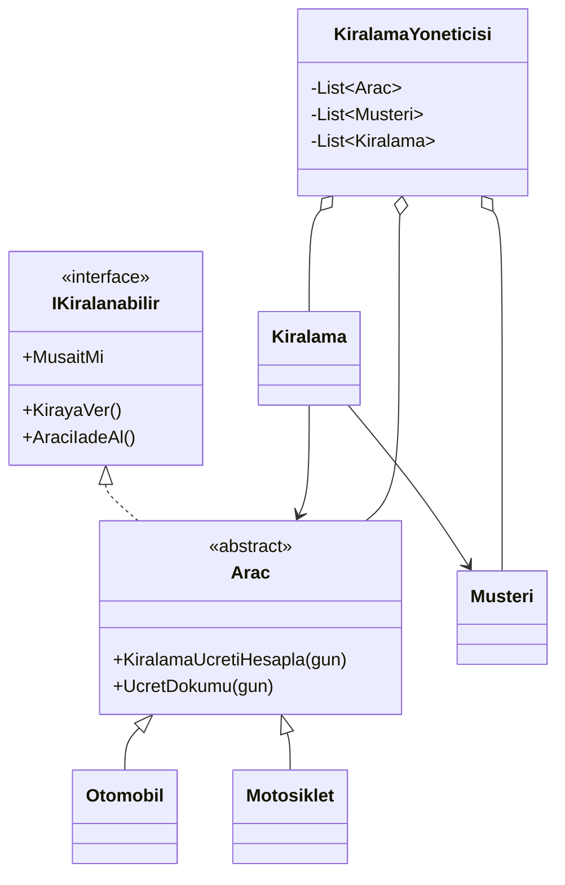
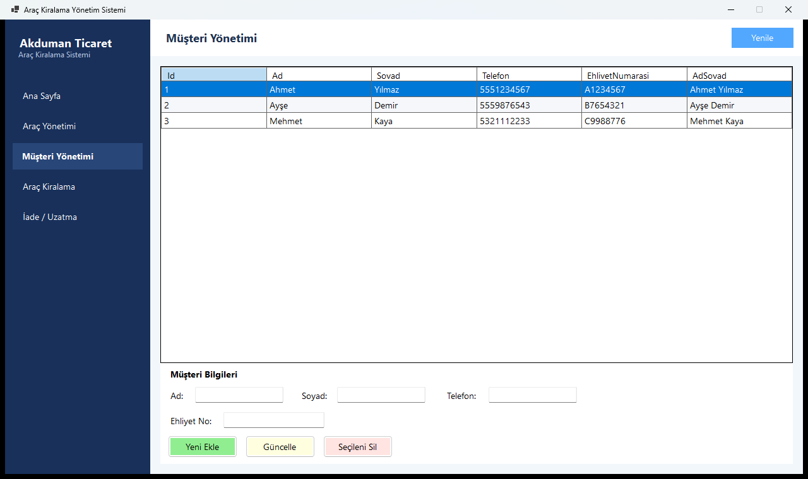
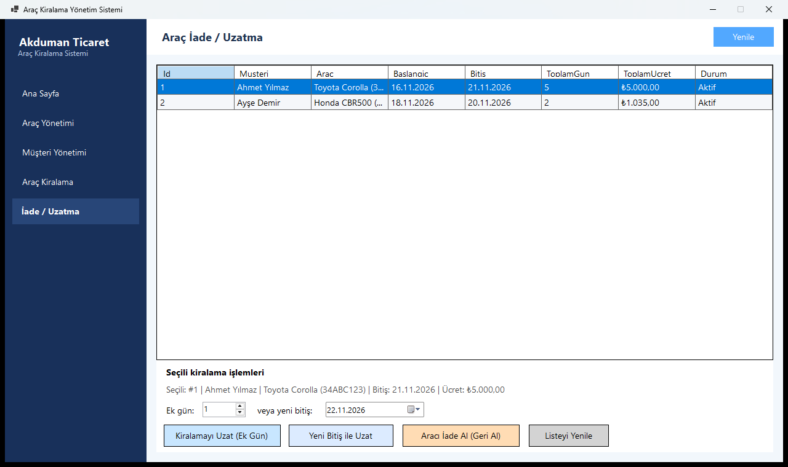

# Araç Kiralama Yönetim Sistemi

C# ve Windows Forms ile yazılmış masaüstü araç kiralama uygulaması. Araç/müşteri yönetimi, kiralama, ücret hesabı, iade ve süre uzatma işlemlerini kapsar.

| | |
|---|---|
| Ders kodu | BGY203 / YBS223 |
| Ders adı | Nesne Tabanlı Programlama |
| Öğrenci | Cemile Akduman |
| Okul no | 25906019 |
| Repo | https://github.com/cemileakduman/AracKiralamaSistemi |

## Özellikler

- Ana sayfa: toplam/müsait/kiradaki araç, müşteri ve aktif kiralama özetleri
- Araç ekleme, güncelleme, silme; plaka / marka / model ile arama; müsait–kirada filtre
- Müşteri ekleme, güncelleme, silme
- Kiralama: yalnızca müsait araçlar, tarih seçimi, ekranda ücret dökümü
- İade: aktif kiralama tamamlanır, araç yeniden müsait olur
- Süre uzatma: ek gün veya yeni bitiş tarihi ile ücret yeniden hesaplanır

Uygulama açılışında örnek veri yüklenir: **4 araç, 3 müşteri, 3 kiralama (2 aktif, 1 tamamlanmış)**.

## Ücret kuralları

| Tip | Kural | Dosya |
|-----|--------|--------|
| Otomobil | 7 günden uzun kiralamada %10 indirim | `Modeller/Otomobil.cs` |
| Motosiklet | Kask dahilse ücrete %15 eklenir | `Modeller/Motosiklet.cs` |

Ortak hesap `Arac.TemelUcretiHesapla` (gün × günlük ücret); alt sınıflar `KiralamaUcretiHesapla` ile kendi kuralını uygular. Kiralama ekranında metin `UcretDokumu` ile gösterilir.

## İş kuralları

- Aynı plaka tekrar eklenemez
- Plaka Türkiye biçimine uygun olmalı (normalize + regex; `Arac.NormalizePlaka`)
- Aynı ehliyet numarası ile ikinci müşteri eklenemez
- Kiralama kaydı bulunan araç silinemez (aktif veya tamamlanmış)
- Aktif kiralaması olan müşteri silinemez
- Yalnızca müsait araç kiralanır
- Bitiş tarihi başlangıçtan önce olamaz

## Gereksinimler

- Windows (WinForms; Linux / macOS desteklenmez)
- .NET 8 SDK veya Visual Studio 2022
- Hedef çerçeve: `net8.0-windows` (`AracKiralamaSistemi.csproj`)

## Çalıştırma

**Visual Studio:** `AracKiralamaSistemi.sln` dosyasını açıp F5.

**Komut satırı (Windows):**

```bash
dotnet run --project AracKiralamaSistemi.csproj
```

## Proje yapısı

```
AracKiralamaSistemi/
├── Forms/
│   ├── AnaForm.cs              # Ana kabuk, dashboard, menü
│   ├── AracYonetimiForm.cs     # Araç CRUD, arama, filtre
│   ├── MusteriYonetimiForm.cs  # Müşteri CRUD
│   ├── KiralamaForm.cs         # Kiralama ve ücret dökümü
│   ├── IadeForm.cs             # İade ve süre uzatma
│   └── ArayuzYardimcisi.cs     # Ortak mesaj / hata yakalama
├── Modeller/
│   ├── Arac.cs                 # Abstract araç sınıfı
│   ├── Otomobil.cs
│   ├── Motosiklet.cs
│   ├── Musteri.cs
│   ├── Kiralama.cs
│   ├── AracDurumu.cs
│   ├── KiralamaDurumu.cs
│   └── DurumUzantilari.cs      # Enum → Türkçe metin
├── Arayüzler/
│   └── IKiralanabilir.cs       # Kiralanabilir sözleşme
├── Servisler/
│   ├── KiralamaYoneticisi.cs   # Listeler ve iş kuralları
│   └── IsKuraliException.cs
├── docs/ekranlar/              # README ekran görüntüleri
├── Program.cs
├── AracKiralamaSistemi.csproj
└── AracKiralamaSistemi.sln
```

Veriler bellekte `List<T>` ile tutulur; dışarıya `IReadOnlyList<T>` verilir. Veritabanı yoktur.

## OOP ilkeleri

**Kapsülleme.** Alanlar `private`, erişim property ile. Örneğin `GunlukKiraUcreti` sıfır veya negatif olamaz; `Arac.Durum` yalnızca `private set` ile değişir (`KirayaVer` / `AraciIadeAl`). Listeler yöneticide gizlidir (`IReadOnlyList`). Dosyalar: `Modeller/Arac.cs`, `Servisler/KiralamaYoneticisi.cs`.

**Kalıtım.** `Otomobil` ve `Motosiklet`, abstract `Arac` sınıfından türer; ortak alanlar ve doğrulamalar bir kez yazılır. Dosyalar: `Modeller/Otomobil.cs`, `Modeller/Motosiklet.cs`.

**Çok biçimlilik.** `KiralamaUcretiHesapla` abstract’tır; her alt sınıf kendi kuralını `override` eder. Yönetici `arac.KiralamaUcretiHesapla(gun)` çağırır, tip kontrolü yapmaz. Dosyalar: `Modeller/Arac.cs`, `Otomobil.cs`, `Motosiklet.cs`.

**Soyutlama.** `IKiralanabilir` kiraya verme / iade sözleşmesini tanımlar; `Arac` bunu uygular. `KiralamaYoneticisi.KirayaVer(IKiralanabilir)` somut tipe bağlı değildir. Dosyalar: `Arayüzler/IKiralanabilir.cs`, `Servisler/KiralamaYoneticisi.cs`.

## Sınıf ilişkileri



## Ekran görüntüleri

### Ana sayfa
Özet kartlar, aktif kiralamalar ve araç durumu.


### Araç yönetimi
Liste, arama/filtre ve ekleme–güncelleme formu.


### Müşteri yönetimi
Müşteri listesi ve form alanları.



### Araç kiralama
Müşteri / müsait araç seçimi ve ücret dökümü.


### İade / uzatma
Aktif kiralama üzerinde iade veya süre uzatma.



## Bilinen sınırlar

- Veriler kalıcı değil; uygulama kapanınca örnek veri yeniden yüklenir (ileride SQLite veya dosya kaydı eklenebilir)
- Birim test projesi yok
- Çok kullanıcılı yetkilendirme veya ödeme yok
- Yalnızca Windows’ta çalışır
