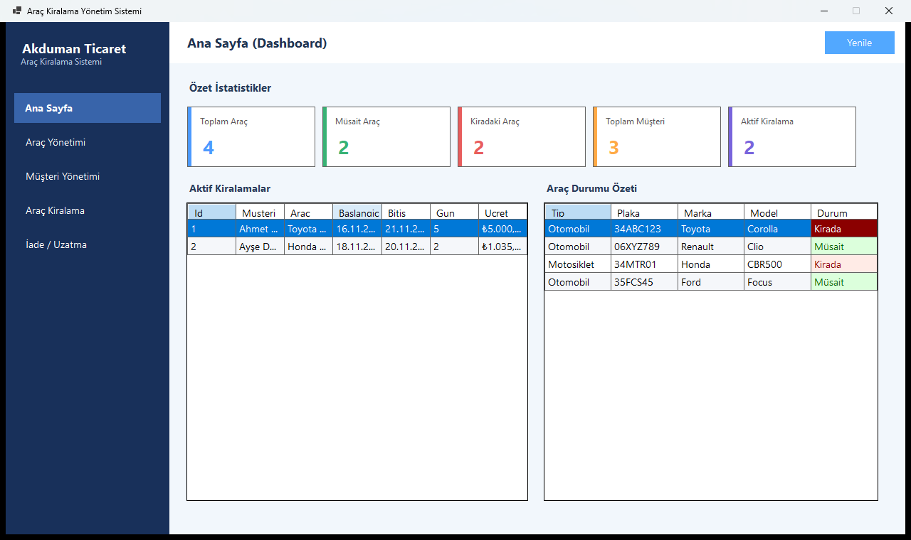
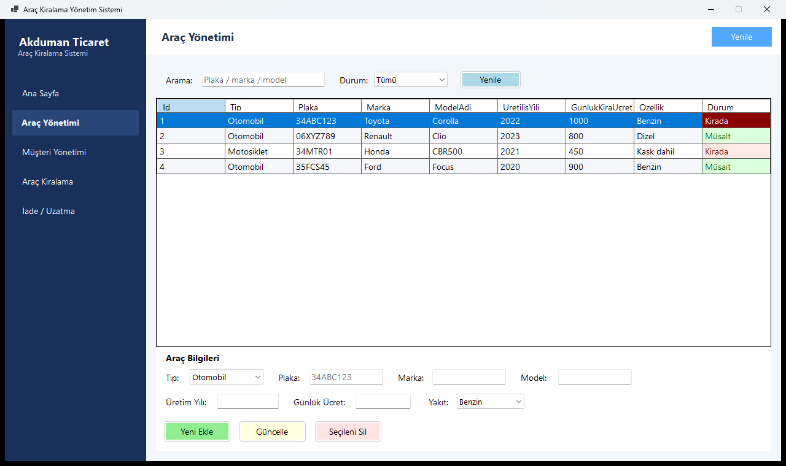
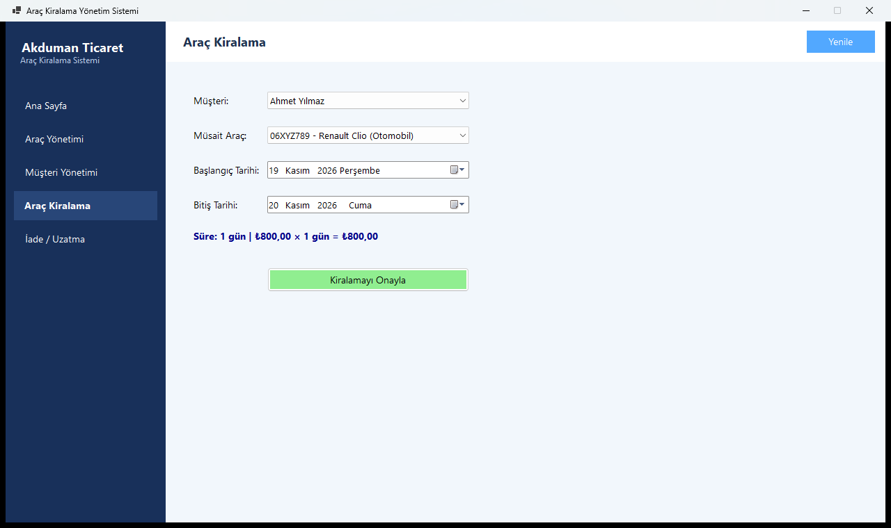

# Araç Kiralama Yönetim Sistemi

Nesne tabanlı programlama dersi için C# / Windows Forms ile yazılmış masaüstü uygulama.

**Öğrenci:** Cemile Akduman — `25906019`  
**Ders:** BGY203 / YBS223 — Nesne Tabanlı Programlama  
**Repo:** https://github.com/cemileakduman/AracKiralamaSistemi

## Ne yapıyor?

Araç ve müşteri kayıtlarını tutuyor; müsait araçları kiraya veriyor, ücreti hesaplıyor, iade ve süre uzatma işlemlerini yönetiyor. Ana sayfada özet bilgiler görünüyor.

## Özellikler

- Ana sayfa: araç / müşteri / aktif kiralama özetleri
- Araç ekleme, güncelleme, silme (plaka kontrolü; kiralaması olan araç silinmez)
- Müşteri ekleme, güncelleme, silme
- Kiralama: sadece müsait araçlar, tarih seçimi, ücret hesabı
- İade ve kiralama uzatma
- Otomobil ve Motosiklet için farklı ücret kuralları

## Nasıl çalıştırılır?

Visual Studio ile `AracKiralamaSistemi.sln` dosyasını açıp F5’e basmanız yeterli.

Komut satırından:

```bash
dotnet run --project AracKiralamaSistemi.csproj
```

## Proje yapısı

```
Forms/          Arayüz formları
Modeller/       Arac, Otomobil, Motosiklet, Musteri, Kiralama
Arayüzler/      IKiralanabilir
Servisler/      KiralamaYoneticisi ve iş kuralları
docs/ekranlar/  Ekran görüntüleri
Program.cs
```

Veriler uygulama açıkken bellekte tutulur (veritabanı yok).

## Ekran görüntüleri

Başlangıçta örnek veri yüklü gelir: 4 araç, 3 müşteri, 2 aktif kiralama.

### Ana sayfa


### Araç yönetimi


### Müşteri yönetimi


### Araç kiralama


### İade / uzatma

